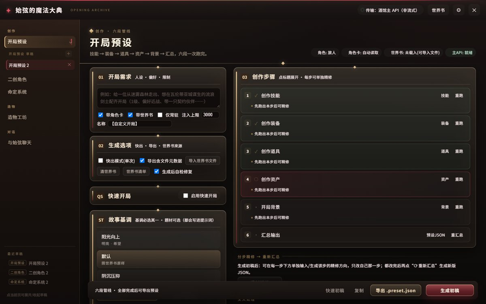
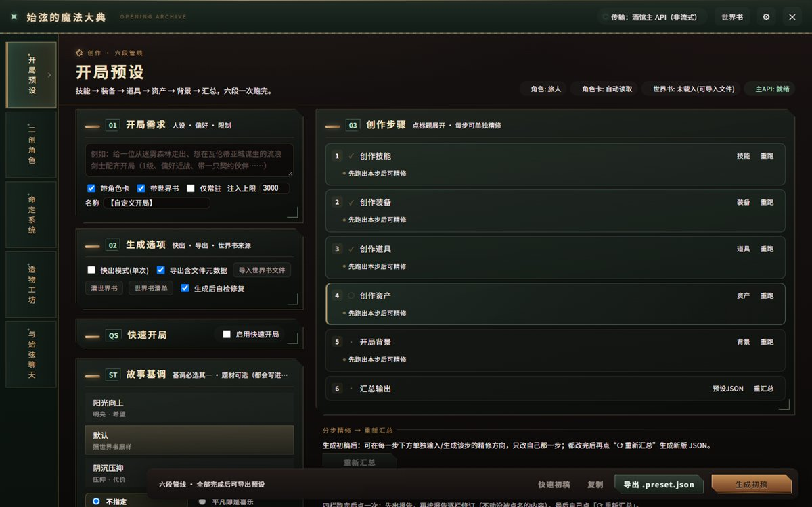
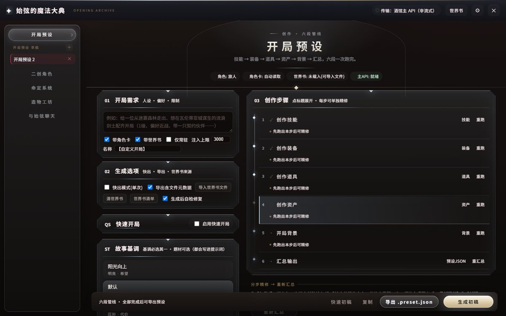

# 始弦的魔法大典 · destiny 开局预设工坊

给「命定之诗与黄昏之歌」这类角色卡做**开局预设**的流水线。装在 SillyTavern 里，从一句需求跑到一份可导入的 `destiny_*.preset.json`。

当前版本 **v1.22.8** · 单文件零依赖 · 只调用酒馆自己的主 API

```
技能 → 装备 → 道具 → 资产 → 背景 → 汇总 JSON → 导出 .preset.json
```

---

## 它长这样

三套界面风格，随时切：

**霜玻璃（默认）** — 暗室读书：烛光、书脊、书签、火漆印



**铜绿机匣** — 竖排机械脊 + 抽屉式卡片，铜与绿锈



**圣银神殿** — 浮空光点导航、中轴时间线、拱门光晕



风格在 **设置 → 界面风格** 里切换，即时生效。

---

## 能做什么

| 页面 | 干什么 |
| --- | --- |
| 开局预设 | 六段管线一次跑完，每步可单独精修，再重新汇总；可导出/复制 JSON |
| 世界书 | 导入与勾选条目，只有勾中的才会发进上下文；支持分类、搜索、地区索引 |
| 二创角色 | 分段写角色设定，产出可粘进世界书 DLC 的 YAML |
| 命定系统 | 分段写命定核心，脚本拼装成品 + lint 自检 |
| 正则工坊 | 从核心到对话美化正则：解析、生成替换体、自检、自动修复 |
| 与始弦聊天 | 基于馆藏聊创作问题 |
| 核心精修 | 给已有命定核心做补丁式改造：锚点落刀、保真校验、行级 diff |
| 造物工坊 | 单件生成 + 自检 + 改进 + 长期工作区，可做交火分析 |

其它顺手的东西：

- **生成后自检**：按内置规范检查字段、品质、标签、点数，不合规就修；返回结果比原稿少条目会拒绝写回
- **交火处理**：四栏跑完后查冲突（人物↔背景、数值、战斗、资产、伙伴、题材、格式），按报告逐栏修订，可撤销
- **反八股与信息边界**：背景与交火阶段注入文风约束，以及「在场≠看见听见」这类知情边界
- **故事基调 / 开局题材**：三档基调、十二种题材，写进提示词
- **本地缓存**：世界书勾选与草稿存 localStorage，重开酒馆自动恢复

---

## 安装

**方式 A · 酒馆里直接装（推荐）**

1. SillyTavern 顶部 **Extensions ▸ Install extension**
2. 填仓库地址：`https://github.com/AkarisRotile/opening-preset-forge`
3. 装完刷新页面

**方式 B · 手动放目录**

把 `index.js` 和 `manifest.json` 放进：

```
SillyTavern/data/<你的用户名>/extensions/opening-preset-forge/
```

---

## 第一次用

1. 打开酒馆左侧的 ✦ 悬浮按钮，进「设置」确认传输走**酒馆主 API**
2. 进「世界书」，导入你那张卡对应的世界书，勾上要发给模型的部分（或勾「快速开局」自动勾）
3. 回「开局预设」，写一句需求（比如「给一位从迷雾森林走出的流浪剑士配齐开局，1 级、偏好近战、带一只契约伙伴」）
4. 点底部 **生成初稿**；跑完可逐步精修，再点 **重新汇总**
5. 导出 `.preset.json`，导进卡的开局预设

更细的说明（世界书分类、每页参数、提示词规则、FAQ）都在 **[使用手册](docs/使用手册.md)**。

---

## 依赖与边界

- 需要 SillyTavern（含 Tavern Helper 环境）；不依赖任何第三方库，不分包、不发请求到第三方域名
- 模型调用全部走 `SillyTavern.getContext().generateRaw`，**不保存、不使用 API Key**
- 所有数据留在本地（localStorage / IndexedDB），没有账号、没有云端
- 导出的 JSON 与 `destiny_AI一键生成开局预设格式.preset.json` 同构

## 常见问题

**生成的条目缺字段 / 点数不对？**
先看「预设 JSON」面板的校验提示；自检会补齐点数并按品质区间校正，缺条目会被拦下。

**换了模型之后效果变差？**
插件的提示词按固定规范写，具体文风与遵循度取决于模型；建议用长上下文、指令跟随较好的模型跑分步，快出模式适合草稿。

**世界书内容被截断了？**
世界书页会显示「有内容被截断」，点「调高上限」把 `capChars` 提上去，或减少勾选条目。

---

## 目录结构

```
index.js          # 构建产物：酒馆只加载这一个文件
manifest.json     # 扩展清单
src/              # 源码（22 个分块，按文件名顺序拼成 index.js）
docs/             # 截图与使用手册
模块地图.md        # 改哪一页读哪一块
```

改源码后跑 `node tools/build.mjs` 重新拼包（`tools/` 只在开发工作区，不随仓库分发）。

## 版本

最近几版：

| 版本 | 内容 |
| --- | --- |
| v1.22.8 | 动效：2 号抽屉滑轨回弹、3 号切页淡入上浮（带 reduced-motion 降级） |
| v1.22.7 | 默认风格去掉与 3 号重复的菱形，改火漆印与书签 |
| v1.22.6 | 2 号抽屉、3 号光点导航与镜面高光 |
| v1.22.5 | 3 号彻底去红，改「圣所」：珍珠金主操作、拱门光晕 |
| v1.22.4 | 默认风格补足图书馆意象：烛光、书脊、书签、扉页压印 |
| v1.22.0 | 界面风格可切换（三套），导航重做，按钮改毛玻璃 |
| v1.21.1 | 修 12 条主流程缺陷（草稿覆盖、精修无守门、合规截断等） |

更早的版本历史在 [使用手册 · 九、版本历史](docs/使用手册.md)。

## 许可与致谢

- 插件本身不含任何第三方美术素材；界面里的图标与装饰都是 CSS / 内联 SVG 画的
- 「命定之诗与黄昏之歌」「始弦」等设定与文案归其原作者所有，本仓库只做工具
- 欢迎提 issue；改代码前建议先读 `模块地图.md`
